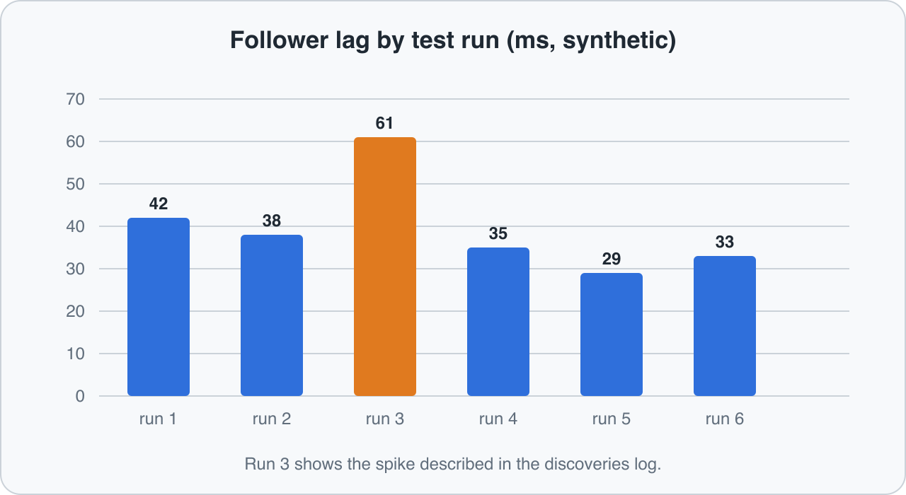

# Toy KV Discoveries

Things that surprised me, kept because each one changed how I read a note.

## Findings

### A split vote can repeat

2026-11-12

With identical timeouts, three nodes became candidates in the same millisecond and none won. It happened for six terms in a row. A random timeout fixed it at once, which is what [the note](/wiki/resources/notes/Raft-Leader-Election.md) says, but I only believed it after seeing the failure.

> [!quote] What I wrote that day
> The randomness is not a detail. It is the algorithm.

### The lag spike in run 3

2026-11-18

Follower lag was 29 to 42 ms in five of six runs, and 61 ms in run 3.

The spike lined up with the leader writing its log to disk while a follower was also fsyncing. Not a protocol problem, a disk one. Next time, record the disk's own latency alongside.

### An old leader keeps writing

2026-11-21

A leader cut off from the others kept accepting client writes for several seconds, because it only noticed the loss of its majority when a heartbeat failed. Those writes were never committed, but the clients had no way to know. The fix is for the leader to step down when it cannot reach a majority, and for clients to ignore answers that did not say "committed". Covered in the [playbook](/wiki/resources/notes/Playbook-Debugging-Replica-Divergence.md).
