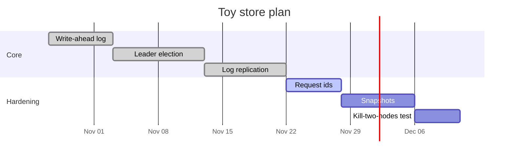

# Toy Replicated KV Store

A project is a time-bound effort with an outcome. Everything stable lives here; the records that grow while the work runs are separate files: [progress](/wiki/projects/Toy-Replicated-KV/progress.md), [decisions](/wiki/projects/Toy-Replicated-KV/decisions.md) and [discoveries](/wiki/projects/Toy-Replicated-KV/discoveries.md).

## Goal

Build a small in-memory key-value store, replicated over five nodes with Raft, to find out whether I really understand the notes in this vault. Done means: kill any two nodes and reads and writes still work; kill a third and writes are refused rather than lost.

## Status

> [!info] Where it stands
> Leader election and log replication work. Snapshots and client request ids are still to do. Last updated 2026-11-22.

## What is left

- [x] Single-node store with a write-ahead log
- [x] [Leader election](/wiki/resources/notes/Raft-Leader-Election.md) with randomized timeouts
- [x] [Log replication](/wiki/resources/notes/Raft-Log-Replication.md) to a majority
- [ ] Client request ids for [idempotent retries](/wiki/resources/notes/Idempotency-and-Retries.md)
- [ ] Snapshots, so the log does not grow forever
- [ ] A test that kills two nodes mid-write
- [ ] Hash sharding across groups ([D-003](/wiki/projects/Toy-Replicated-KV/decisions.md#d-003-hash-sharding-with-virtual-nodes))

## Background

I read about replication for a month and could recite the rules without being able to say what breaks when one is wrong. Building the thing is the fastest way to find the gaps. Related notes: [[Quorum-Reads-and-Writes]], [[How-Many-Replicas-Do-I-Need]].

## Plan

## Validation

The project is done when this table is all green:

| Scenario | Expected | Status |
| --- | --- | :---: |
| Kill 1 follower during writes | No write lost | Pass |
| Kill the leader | New leader within 500 ms | Pass |
| Kill 2 nodes | Reads and writes still work | Not yet |
| Kill 3 nodes | Writes refused, nothing lost | Not yet |

## Retrospective

*Not yet written.* I will write it when the deadline passes, whatever state the project is in.

## Records

- [Progress](/wiki/projects/Toy-Replicated-KV/progress.md): dated log of what happened
- [Decisions](/wiki/projects/Toy-Replicated-KV/decisions.md): what I chose and why
- [Discoveries](/wiki/projects/Toy-Replicated-KV/discoveries.md): what surprised me

## Related

- Area: [Distributed Systems Study](/wiki/areas/Distributed-Systems-Study.md)
- Playbook: [Debugging replica divergence](/wiki/resources/notes/Playbook-Debugging-Replica-Divergence.md)
