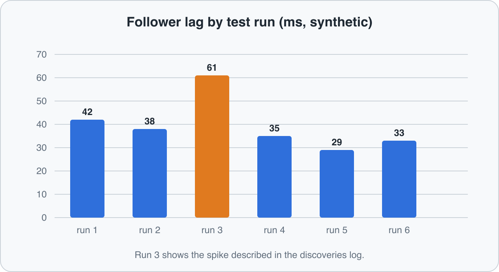

# Toy KV Progress

Newest first. Each entry is a `###` heading with a date, so other notes can embed or link a single day.

## Log

### 2026-11-21

Four nodes now agree on a leader after I kill the old one. Wrote the first test for the [divergence playbook](/wiki/resources/notes/Playbook-Debugging-Replica-Divergence.md): an old leader keeps accepting writes after it loses its majority. The test fails, which is the correct result before the fix.

- [x] Reproduce the stale-leader writes
- [ ] Make the leader step down when it cannot reach a majority

### 2026-11-18

Replication to a majority works. Follower lag is around 40 ms on my laptop, with one spike. See [discoveries](/wiki/projects/Toy-Replicated-KV/discoveries.md#the-lag-spike-in-run-3).

### 2026-11-12

Added randomized election timeouts, 150 to 300 ms. Before that three nodes became candidates at the same moment and split the vote for several terms. [Why it is random](/wiki/resources/notes/Raft-Leader-Election.md#how-an-election-goes).

### 2026-11-04

Chose majority quorums ([D-002](/wiki/projects/Toy-Replicated-KV/decisions.md#d-002-majority-quorums-for-reads-and-writes)) and wrote down [how many replicas I need](/wiki/resources/notes/How-Many-Replicas-Do-I-Need.md).

### 2026-10-27

Started. A single-node store with a write-ahead log, no networking yet. Picked Raft ([D-001](/wiki/projects/Toy-Replicated-KV/decisions.md#d-001-use-raft-for-replication)).
