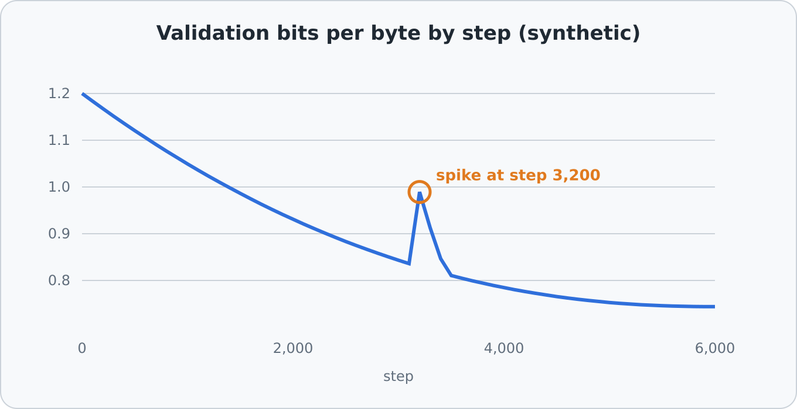

# Progress

Newest first. Numbers are synthetic.

## 2026-11-26

P-003 · Pretraining finished. Validation bits per byte ended near 0.75, with one spike on the way:

Worked through it with the [loss spike playbook](/wiki/resources/notes/Playbook-Debugging-a-Loss-Spike.md); see the [discovery](/wiki/projects/Train-a-Tiny-Chat-Model/discoveries.md#a-spike-from-one-bad-shard).

## 2026-11-25

P-002 · Started pretraining at depth 12 on one GPU. Throughput looked low; checked the dtype table in the README and confirmed bf16 was on.

## 2026-11-21

P-001 · Trained the tokenizer and read its compression rate with `scripts/tok_eval.py`. Wrote [[BPE-Tokenization]] the same evening.
