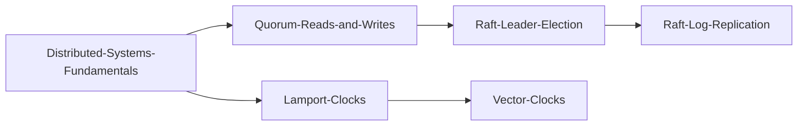

# Distributed Systems Map

A map of content is a hub, not a folder: notes live flat in `wiki/resources/notes/` and are reached by following the links here. This is the top-level map; it points to three smaller ones.

## The big picture

Nodes in this diagram are written as `class X internal-link;`, so clicking one opens the note with that name.

## The three sub-maps

- [Consensus and Replication Map](/wiki/resources/mocs/Consensus-and-Replication-Map.md): quorums, leaders, logs and commit.
- [Time and Ordering Map](/wiki/resources/mocs/Time-and-Ordering-Map.md): clocks, causality and convergence.
- [Sources and Reading Map](/wiki/resources/mocs/Sources-and-Reading-Map.md): what the notes are based on.

## Core notes

- [[Distributed-Systems-Fundamentals]]: start here
- [[CAP-Theorem]]
- [[Consistent-Hashing]]
- [[Idempotency-and-Retries]]
- [Distributed Systems Glossary](/wiki/resources/notes/Distributed-Systems-Glossary.md)
- [Learning path](/wiki/resources/notes/Learning-Path-Distributed-Systems.md)

## Workbench

- [Sandbox: try Lumiere here](/wiki/resources/notes/Sandbox-Try-Lumiere-Here.md), a scratch note to edit freely.

## All notes, live

This table is a `.base` file ([Obsidian Bases](https://help.obsidian.md/bases)) embedded here. It reads each note's properties, so changing `status` in a note changes its row.

![[Study-Notes.base#All notes]]

Or as cards grouped by how mature each note is:

![[Study-Notes.base#By maturity]]

## Open questions

- Where do the notes about *building* (the toy store) belong: a map of their own, or the project?
- What is the smallest set of notes I could explain to someone in an hour?
