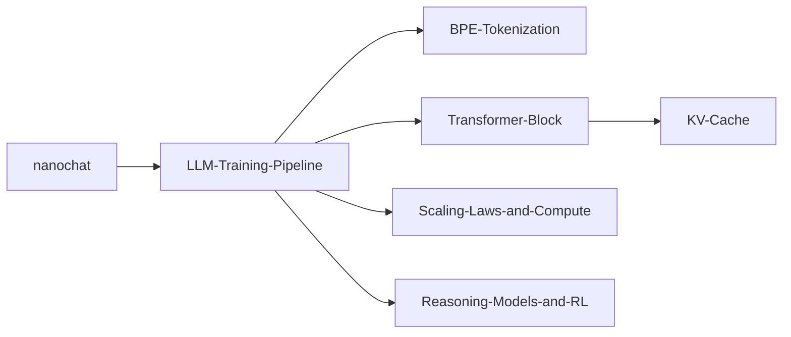

# LLM Map

A map of content is a hub, not a folder: notes live flat in `wiki/resources/notes/` and are reached by following links. This is the top-level map; it points to two smaller ones.

## The big picture

Nodes in this diagram are written as `class X internal-link;`, so clicking one opens the note with that name.

## The two sub-maps

- [Training and Inference Map](/wiki/resources/mocs/Training-and-Inference-Map.md): how a model is built and served.
- [Sources and Reading Map](/wiki/resources/mocs/Sources-and-Reading-Map.md): the PDFs and what the notes are based on.

## Recent progress

- [[Time-to-GPT-2-Leaderboard]]: pretraining keeps getting faster.
- [[Reasoning-Models-and-RL]]: models that think before answering.
- [[What-Does-a-Tiny-Chat-Model-Cost]]: the price of a GPT-2 grade model today.

## Reference

- [LLM Glossary](/wiki/resources/notes/LLM-Glossary.md)
- [Learning path](/wiki/resources/notes/Learning-Path-LLMs.md)
- [Sandbox: try Lumiere here](/wiki/resources/notes/Sandbox-Try-Lumiere-Here.md), a scratch note to edit freely

## All notes, live

This table is a `.base` file ([Obsidian Bases](https://help.obsidian.md/bases)) embedded here. It reads each note's properties, so changing `status` in a note changes its row.

![[Study-Notes.base#All notes]]

Or as cards grouped by how mature each note is:

![[Study-Notes.base#By maturity]]
