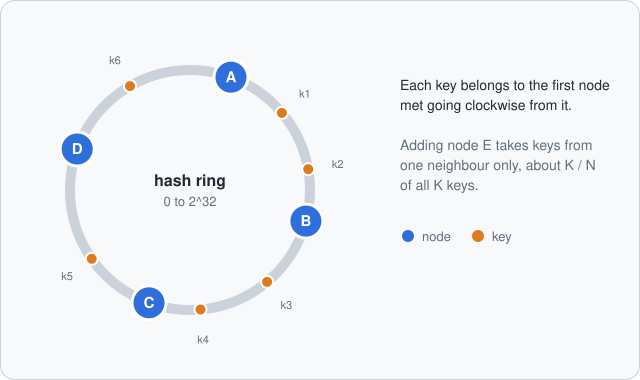

# Consistent Hashing

Spreading keys over $N$ machines with `hash(key) % N` works until $N$ changes: then almost every key moves. Consistent hashing puts both keys and nodes on a ring, so a change moves only the keys next to the node that came or went.



## The idea

1. Hash each node's name to a point on a ring.
2. Hash each key to a point on the same ring.
3. A key belongs to the first node clockwise from it.

Adding a node takes keys from one neighbour only. Removing one hands its keys to the next node. On average that is $K/N$ of $K$ keys, instead of nearly all of them.

## Virtual nodes

With few nodes the arcs are uneven and one node can own most of the ring. Giving each machine many points (virtual nodes) evens the load, and lets a bigger machine take more points.

```python
import bisect
import hashlib


def h(value: str) -> int:
    return int.from_bytes(hashlib.sha1(value.encode()).digest()[:8], "big")


class Ring:
    def __init__(self, nodes, vnodes=64):
        self.points = sorted((h(f"{n}#{i}"), n) for n in nodes for i in range(vnodes))
        self.hashes = [p for p, _ in self.points]

    def owner(self, key: str) -> str:
        i = bisect.bisect(self.hashes, h(key)) % len(self.points)
        return self.points[i][1]


ring = Ring(["A", "B", "C"])
print(ring.owner("user:42"))
```

## Play with it

A small page, drawn by hand for this vault, lets you add and remove nodes and watch keys move. It is a local `.html` file, so Lumiere shows it as a card that opens it in the Integrated Browser, or as text where the window has none.

![[consistent-hashing-ring.html]]

> [!note] Replication on a ring
> A key is usually stored on its owner *and* the next $n-1$ nodes clockwise. That list is the key's preference list, and it is where the quorums in [Quorum reads and writes](/wiki/resources/notes/Quorum-Reads-and-Writes.md) are drawn from.

## Related

- [Gossip protocols](/wiki/resources/notes/Gossip-Protocols.md) spread the membership list that the ring is built from.
- The toy store shards by hash: see [D-003](/wiki/projects/Toy-Replicated-KV/decisions.md#d-003-hash-sharding-with-virtual-nodes).
