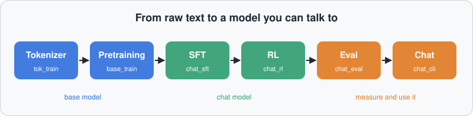
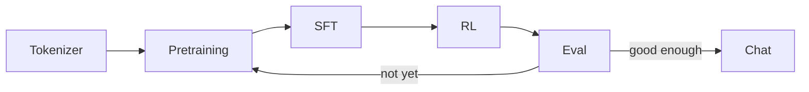

# LLM Training Pipeline

## The short version

A chat model is built in stages. A **tokenizer** turns text into integers, **pretraining** teaches a base model to predict the next token, **supervised finetuning** teaches it to hold a conversation, **reinforcement learning** rewards answers that can be checked, and **evaluation** tells you whether any of it worked. ^short-version

## The stages as a graph

## Where the compute goes

Almost all of it goes into pretraining, which is why the [Time-to-GPT-2 leaderboard](/wiki/resources/notes/Time-to-GPT-2-Leaderboard.md) is about that stage. The later stages are small by comparison but change behaviour the most; [[SFT-vs-RL]] compares the two.

| Stage | Learns | Data |
| --- | --- | --- |
| Tokenizer | a vocabulary | a text sample |
| Pretraining | facts and fluency | a large web corpus |
| SFT | the shape of a chat | conversations |
| RL | to get checkable answers right | problems with a checker |

## See also

- [[nanochat]], which has one script per stage
- [[BPE-Tokenization]] and [[Transformer-Block]] for the first two stages
- [Reasoning models and RL](/wiki/resources/notes/Reasoning-Models-and-RL.md) for the last
