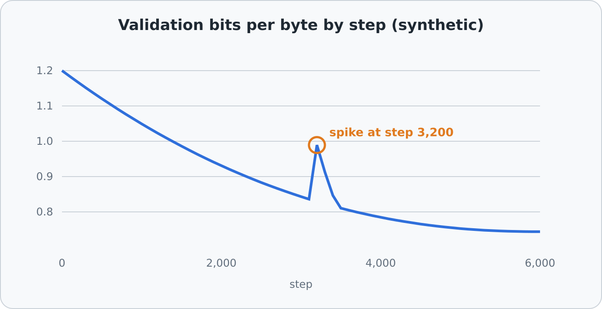

# Playbook: Debugging a Loss Spike

The validation curve jumps up, then (maybe) comes back down. This is the order I check things in. The chart is from my own [project run](/wiki/projects/Train-a-Tiny-Chat-Model/progress.md) and is synthetic.



## 1. Is it real?

Find the step and look at the data around it.

```bash
# which shard was being read at the spike?
grep -n "step 32" logs/train.log | head
# compare the learning rate schedule at that point
grep -n "lr" logs/train.log | sed -n '30,35p'
```

> [!question]- Did a bad shard arrive at that step?
> A batch of junk text (repeated lines, binary, another language) spikes the loss for exactly one evaluation. Skip the shard and rerun from the last checkpoint.

> [!question]- Did the learning rate jump?
> A warmup that ends too early or a schedule bug shows as a spike right at a schedule boundary.

> [!question]- Is the precision too low?
> Lower-precision formats save time (the [leaderboard](/wiki/resources/notes/Time-to-GPT-2-Leaderboard.md) shows fp8 doing so) but an overflow can show up as a sudden spike. Retry the window in a wider format to compare.

## 2. Did it recover?

If the curve returns to its trend within a few hundred steps, note it in the [discoveries](/wiki/projects/Train-a-Tiny-Chat-Model/discoveries.md) and move on. If it does not, roll back to the checkpoint before the spike.

## 3. Write it down

Every spike gets a line in the project's discoveries, even the boring ones.
