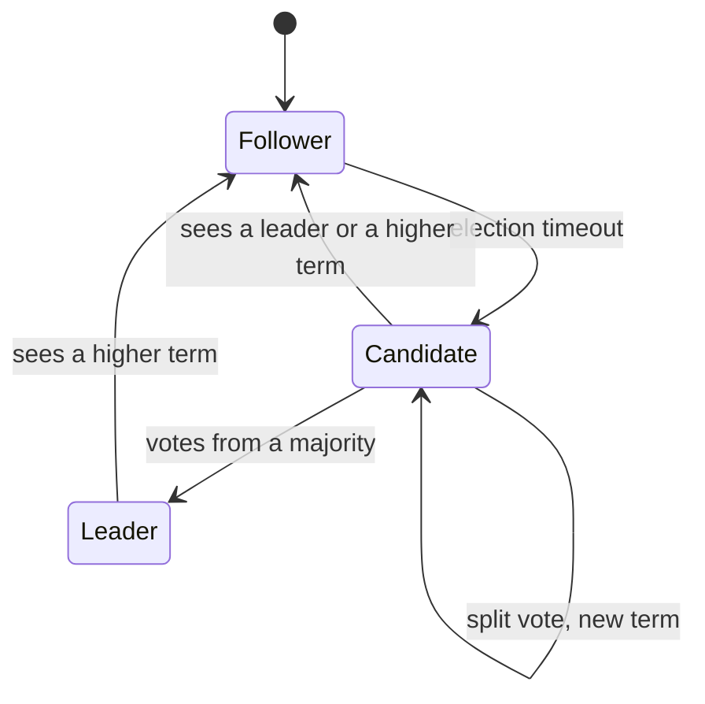

# Raft Leader Election

Raft keeps a replicated log by electing one leader at a time. The leader orders the writes, the others copy them. This note covers how the leader is chosen; [Raft log replication](/wiki/resources/notes/Raft-Log-Replication.md) covers what it does next.

## Roles and terms

Every server is a **follower**, a **candidate** or the **leader**. Time is cut into numbered **terms**, each with at most one leader. A server that sees a higher term than its own immediately adopts it and steps down.



## How an election goes

1. A follower hears nothing from a leader for a random **election timeout**, so it becomes a candidate, increments its term and votes for itself.
2. It asks everyone else for a vote.
3. A server grants **one vote per term**, and only to a candidate whose log is at least as up to date as its own.
4. A candidate with votes from a majority becomes leader and starts sending heartbeats.
5. If nobody wins (a split vote), the timeouts expire again at different moments and a new term starts.

> [!note] Why the timeout is random
> If every follower used the same timeout they would all become candidates together and split the vote forever. A random value, for example between 150 and 300 ms, makes one of them go first.

## Timing

Heartbeats must be far quicker than the timeout, and the timeout far quicker than the time between failures:

$$\text{broadcastTime} \ll \text{electionTimeout} \ll \text{MTBF}$$

Too short a timeout and a slow network triggers needless elections. Too long and a dead leader takes the cluster down for that long.

## A vote handler

```go
// RequestVote is a sketch: persistence and the log check are simplified.
func (n *Node) RequestVote(req VoteRequest) VoteReply {
	n.mu.Lock()
	defer n.mu.Unlock()

	if req.Term < n.currentTerm {
		return VoteReply{Term: n.currentTerm, Granted: false}
	}
	if req.Term > n.currentTerm {
		n.currentTerm, n.votedFor = req.Term, ""
		n.state = Follower
	}
	upToDate := req.LastLogTerm > n.lastLogTerm() ||
		(req.LastLogTerm == n.lastLogTerm() && req.LastLogIndex >= n.lastLogIndex())
	if (n.votedFor == "" || n.votedFor == req.CandidateID) && upToDate {
		n.votedFor = req.CandidateID
		return VoteReply{Term: n.currentTerm, Granted: true}
	}
	return VoteReply{Term: n.currentTerm, Granted: false}
}
```

> [!todo] Open in the toy store
>
> - [x] Randomized election timeout
> - [x] One vote per term
> - [ ] Persist `currentTerm` and `votedFor` before replying
> - [ ] Pre-vote, so a partitioned node cannot disrupt a healthy cluster
