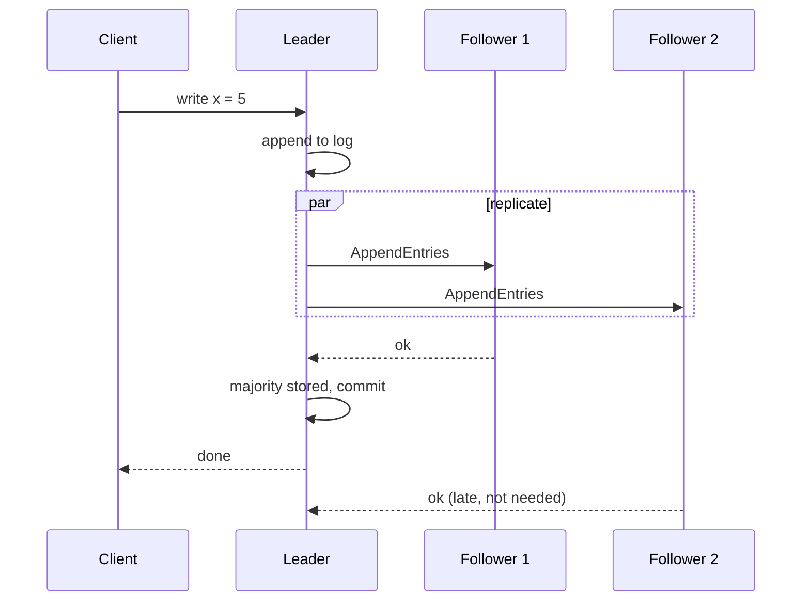

# Raft Log Replication

Once a leader is elected ([Raft leader election](/wiki/resources/notes/Raft-Leader-Election.md)), every client write goes through it as an entry in an ordered log.

## The flow

1. The client sends a command to the leader.
2. The leader appends it to its own log and sends `AppendEntries` to the followers.
3. When a **majority** of servers have stored the entry, the leader marks it **committed**, applies it to its state machine and answers the client.
4. Followers learn the new commit index from later heartbeats and apply the entry too.



## The consistency check

Each `AppendEntries` names the entry just before the new ones, by index and term. A follower that does not have that entry refuses, and the leader backs up one step and tries again until the logs agree, then overwrites the rest.

```go
type AppendEntries struct {
	Term         uint64
	LeaderID     string
	PrevLogIndex uint64 // entry just before the new ones
	PrevLogTerm  uint64 // its term: the follower must match both
	Entries      []Entry
	LeaderCommit uint64 // how far the leader has committed
}
```

> [!important] Committed means safe
> An entry stored on a majority survives any future leader, because a candidate needs a majority's votes and its log must be at least as up to date as theirs, so at least one voter holds the entry. This is the same overlap argument as for [quorums](/wiki/resources/notes/Quorum-Reads-and-Writes.md).

## Related

- The divergent-log case: [Playbook: debugging replica divergence](/wiki/resources/notes/Playbook-Debugging-Replica-Divergence.md)
- Raft is a *replicated log*, commit across several shards needs [two-phase commit](/wiki/resources/notes/Two-Phase-Commit.md) on top.
