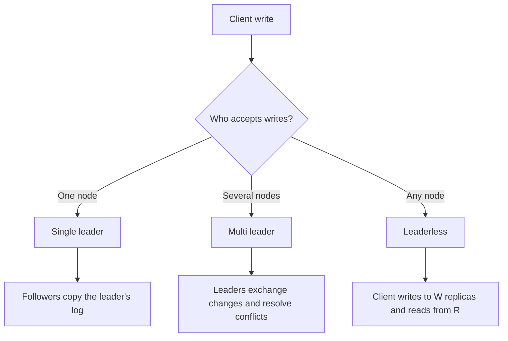

# Replication Strategies

There are three ways to decide who may accept a write. Each gives a different answer to "what if two people write at once?"

## Side by side

| Strategy | Write path | Conflicts | Good for | Watch out for |
| --- | --- | --- | --- | --- |
| Single leader | One node orders every write | None, the leader decides | Strong consistency, simple reasoning | Failover time, leader as a bottleneck |
| Multi leader | Nearest leader, copied later | Must be detected and merged | Several regions, offline editing | Conflict resolution rules |
| Leaderless | Client talks to several replicas | Versions and read repair | High availability | Stale reads when $R + W \le N$ |

## Leaderless, in one section

The quorum arithmetic that makes leaderless systems work is its own note. Here is the part to remember:

![[Quorum-Reads-and-Writes#Choosing R and W]]

## Synchronous or asynchronous

A leader can wait for followers before it answers the client, or answer first and ship the change later.

- **Synchronous:** a follower always has the write, so failover loses nothing, but one slow follower slows every write.
- **Asynchronous:** fast, but a leader that crashes right after answering can take acknowledged writes with it.
- **Semi-synchronous:** wait for one or a majority of followers, and let the rest lag. This is what [Raft](/wiki/resources/notes/Raft-Log-Replication.md) does.

> [!bug] A failure worth remembering
> An asynchronous leader acknowledges write 41, then crashes before sending it. A follower is promoted and accepts write 41' with the same position. When the old leader returns, two histories claim slot 41. See the [divergence playbook](/wiki/resources/notes/Playbook-Debugging-Replica-Divergence.md).
