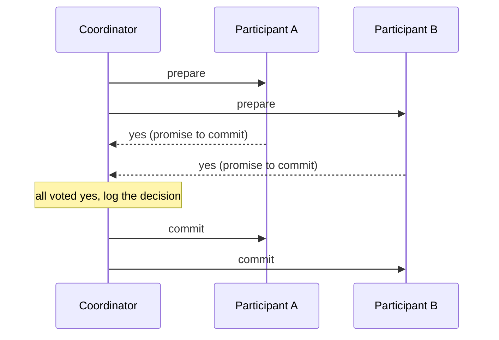

# Two-Phase Commit

Two-phase commit (2PC) lets several nodes agree to commit or abort one transaction together. A **coordinator** drives it and the **participants** hold the data.

## The two phases

1. **Prepare.** Each participant checks it *can* commit, writes the transaction to durable storage, and votes yes or no. A yes is a promise: it may no longer abort on its own.
2. **Commit or abort.** If every vote is yes the coordinator logs *commit* and tells everyone. One no, or a missing vote, means *abort*.

> [!failure] The blocking problem
> A participant that voted yes and then loses the coordinator cannot decide alone: the coordinator may have decided either way. It must hold its locks and wait. A coordinator crash between the phases can therefore stall the transaction until it returns.

## Compared with consensus

| | Two-phase commit | Consensus (Raft, Paxos) |
| --- | --- | --- |
| Agrees on | One yes/no per transaction | An ordered sequence of values |
| Needs | *All* participants to vote yes | A *majority* to respond |
| A node down | Blocks or aborts | Continues if a majority is up |
| Coordinator | A single point of failure | Replaced by election |

The usual fix is to make the coordinator itself a replicated state machine, so that its decision survives its crash.

## Open questions

- [ ] What does three-phase commit change, and why is it rarely used?
- [ ] How do systems that shard data on a [hash ring](/wiki/resources/notes/Consistent-Hashing.md) run cross-shard transactions without 2PC?
